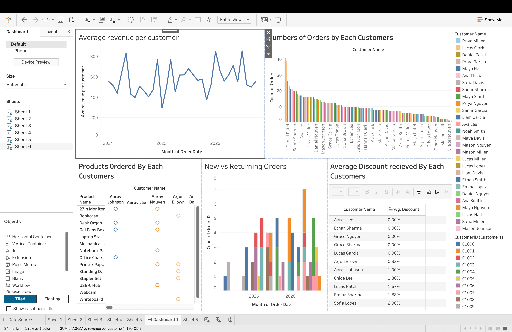

# 1ST Northwind Sales Analysis

## Project Overview
This project analyzes sales data from the fictional Northwind 
company using SQL. It includes 7 queries that uncover business 
insights about revenue, products, employees, and customers.

## Dashboard Preview
## Live Dashboard
[View the interactive dashboard on Tableau Public]https://public.tableau.com/app/profile/debin.thapa6598/viz/Tableaudashboard_17947124376640/Dashboard1?publish=yes

## Business Questions Answered
- How does average revenue per customer change from month to month?
- How many orders does each customer place, and who are the most frequent buyers?
- Which products does each customer order?
- How do new customer orders compare with returning customer orders over time?
- What average discount does each customer receive?

## Tools Used
- SQL (SQLite)
- VS Code
- GitHub
- Tableau
## 2ND ANALYSIS
## Analysis Highlights

- Identified monthly revenue decline trends using LAG() 
  window function and RANK() in SQL
- June 2017 had the highest revenue decline
- Built Excel dashboard to visualize findings
- Dataset: Northwind (fictional company data)
## Author
Debin Thapa
Computer Science Student — Youngstown State University
